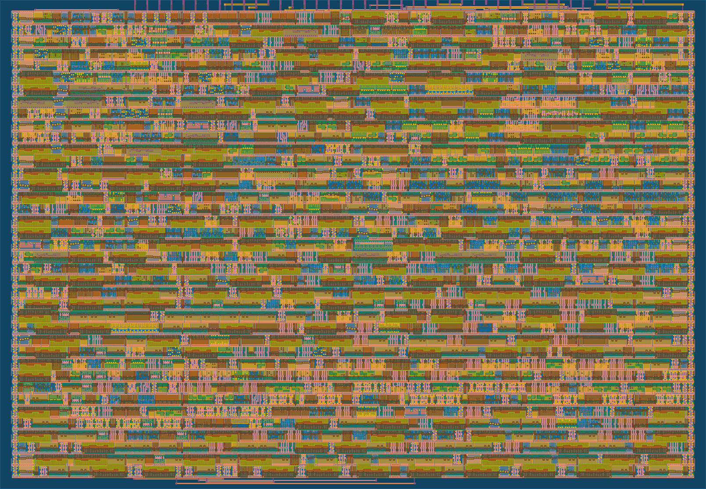
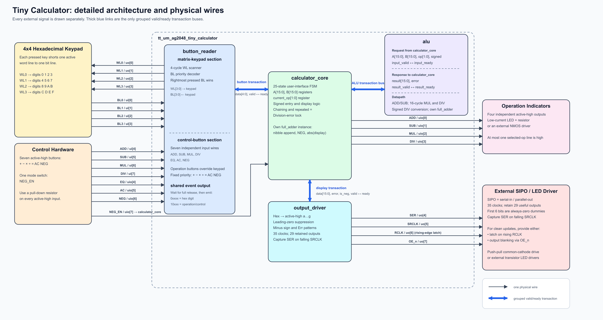
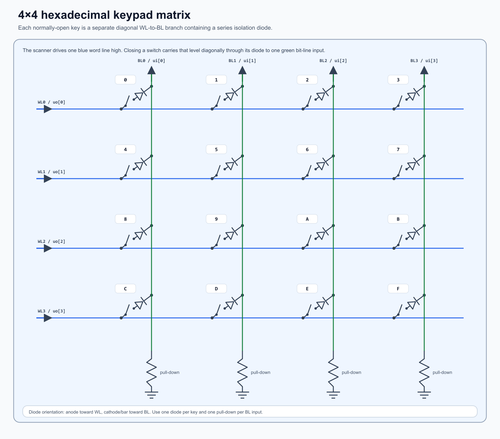
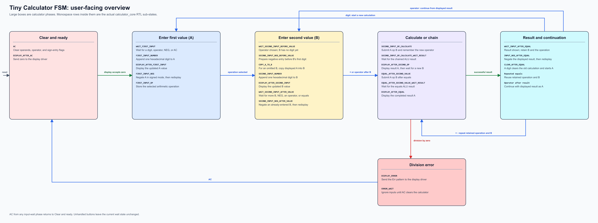
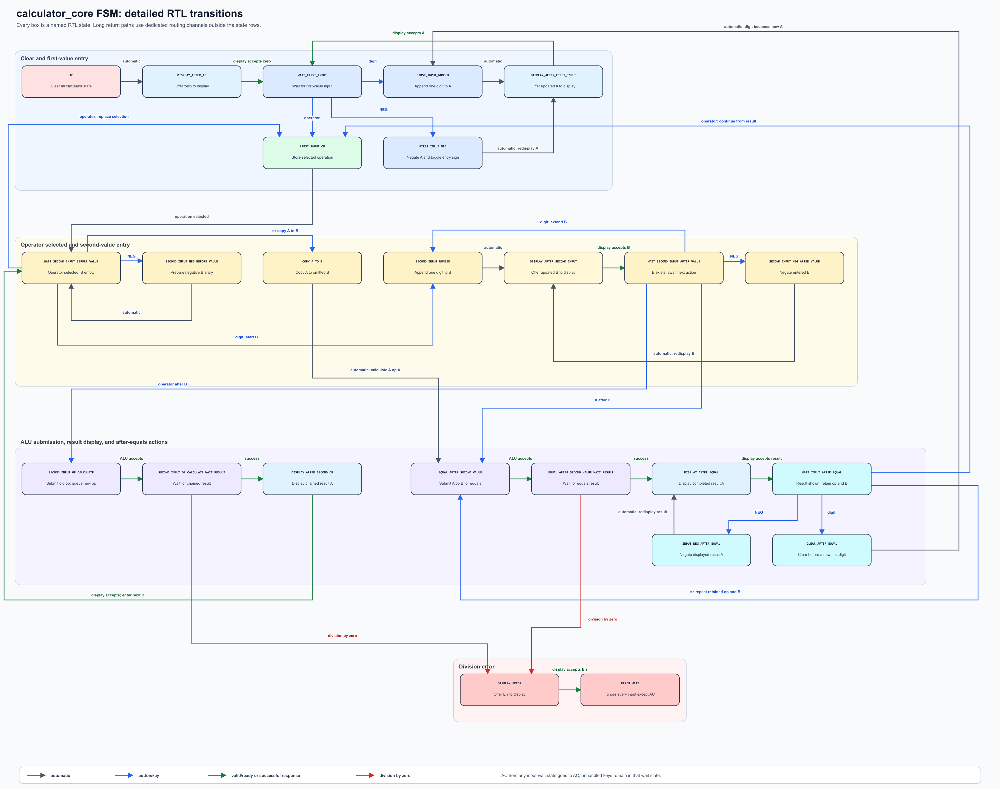

   

# Tiny Calculator ASIC

Tiny Calculator is a 16-bit hexadecimal calculator designed for manufacture through Tiny Tapeout. It scans a 4×4 keypad, accepts dedicated arithmetic and control buttons, performs unsigned or two's-complement arithmetic, and streams the result to five seven-segment display positions through an external shift-register chain.

The design was manufactured on the [TTSKY25b shuttle](https://tinytapeout.com/chips/ttsky25b/) as [Tiny Calculator](https://tinytapeout.com/chips/ttsky25b/tt_um_ag2048_tiny_calculator), project-selection address **546**.

The following image shows the GDS layout render of the Tiny Calculator ASIC.


For physical wiring, electrical protection, first power-up, the required falling-edge `SRCLK` workaround, and calculator key sequences, read the **[ASIC bring-up guide](docs/info.md)**. This README explains how the RTL is organized internally.



## Design summary

The top-level `tt_um_ag2048_tiny_calculator` connects four functional modules:

1. `button_reader` scans the hexadecimal matrix and watches seven independent control buttons.
2. `calculator_core` owns the user-facing calculator state, operand entry, selected operation, chaining, and display coordination.
3. `alu` performs 16-bit addition, subtraction, multiplication, and division.
4. `output_driver` converts values to active-high seven-segment patterns and serializes each display update.

The diagram draws every external wire separately. Thick blue links are the only grouped internal transaction buses; they use valid/ready handshakes so a producer holds its transaction until the consumer can accept it.

## Complete pinout

### Dedicated inputs: `ui_in[7:0]`

| Bit | Name | Description |
| --- | --- | --- |
| 0 | `i_BL0` | Active-high keypad bit line 0 |
| 1 | `i_BL1` | Active-high keypad bit line 1 |
| 2 | `i_BL2` | Active-high keypad bit line 2 |
| 3 | `i_BL3` | Active-high keypad bit line 3 |
| 4 | `i_ADD` | Active-high addition-button input |
| 5 | `i_SUB` | Active-high subtraction-button input |
| 6 | `i_MUL` | Active-high multiplication-button input |
| 7 | `i_DIV` | Active-high division-button input |

### Dedicated outputs: `uo_out[7:0]`

| Bit | Name | Description |
| --- | --- | --- |
| 0 | `o_WL0` | Active-high keypad word line for `0`–`3` |
| 1 | `o_WL1` | Active-high keypad word line for `4`–`7` |
| 2 | `o_WL2` | Active-high keypad word line for `8`–`B` |
| 3 | `o_WL3` | Active-high keypad word line for `C`–`F` |
| 4 | `o_SER` | Active-high seven-segment serial data |
| 5 | `o_SRCLK` | Shift clock; external hardware must capture on its falling edge |
| 6 | `o_RCLK` | Storage/shadow-latch clock; capture on its rising edge |
| 7 | `o_OE_n` | Active-low shift-register output enable |

### Fixed-direction bidirectional bank: `uio[7:0]`

The design drives `uio_oe = 8'b00001111`, so `uio[3:0]` are always outputs and `uio[7:4]` are always inputs.

| Bit | Direction | Name | Description |
| --- | --- | --- | --- |
| 0 | Output | `o_ADD` | High while addition is selected |
| 1 | Output | `o_SUB` | High while subtraction is selected |
| 2 | Output | `o_MUL` | High while multiplication is selected |
| 3 | Output | `o_DIV` | High while division is selected |
| 4 | Input | `i_EQ` | Active-high equals button |
| 5 | Input | `i_AC` | Active-high all-clear button |
| 6 | Input | `i_NEG` | Active-high sign-toggle button |
| 7 | Input | `i_NEG_EN` | Low for unsigned; high for signed two's-complement operation |

### Tiny Tapeout control pins

| Pin | Use |
| --- | --- |
| `clk` | Drives keypad scanning, all state machines, iterative arithmetic, and display serialization |
| `rst_n` | Active-low synchronous reset used throughout the design |
| `ena` | Ignored; Tiny Tapeout keeps it high while the project is selected |

## Button reader



### Matrix scan and encoding

A two-bit counter continuously selects one one-hot WL value:

```text
counter 00 -> WL0 -> 0 1 2 3
counter 01 -> WL1 -> 4 5 6 7
counter 10 -> WL2 -> 8 9 A B
counter 11 -> WL3 -> C D E F
```

The upper two bits of a digit are the row counter; the lower two come from the asserted BL. Within one row, the `casez` decoder gives `BL3 > BL2 > BL1 > BL0` priority. Digits are emitted as `0xxxx`. Control inputs are emitted as `10xxx`:

| Event | Code |
| --- | --- |
| `0`–`F` | `0_0000` through `0_1111` |
| `ADD` | `1_0000` |
| `SUB` | `1_0001` |
| `MUL` | `1_0010` |
| `DIV` | `1_0011` |
| `EQ` | `1_0100` |
| `AC` | `1_0101` |
| `NEG` | `1_0110` |

The reader records activity over complete scans. It may replace the candidate value as additional buttons are observed, but it raises `o_valid` only after all matrix and control buttons have been released for a complete four-row scan. The core then consumes the event through `o_valid/i_ready`. A held key consequently creates one release-latched event rather than auto-repeat.

This logic is **not mechanical debouncing**. The inputs are synchronous samples rather than asynchronous triggers, and the complete-release scan naturally ignores contact interruptions that do not occupy a whole released scan. Bounce can still cause an early or duplicate event if the sampled pattern looks like a complete release followed by another press. Many switch and clock combinations may work without extra debounce; test the real hardware and see the [bring-up guide](docs/info.md#input-release-behavior-and-optional-debounce) if conditioning is needed.

### Multiple simultaneous buttons

The result is deterministic for a particular scan phase and release order:

- Same row: highest asserted BL wins (`BL3` first).
- Different rows: the most recently observed qualifying row/key before complete release remains in the output register.
- Mixed rows and columns: BL priority applies during each active row, followed by the latest-observed behavior across rows.
- Dedicated controls have `ADD > SUB > MUL > DIV > EQ > AC > NEG` priority while asserted.
- A dedicated control overrides a matrix digit during that sample. If it releases earlier while another key stays down, the later matrix sample can replace it.

The reader deliberately waits for full release so closely spaced or simultaneous presses collapse to one event. At a high scan rate, human release timing normally determines which event is last (buttons are likely to be released at different scan cycles). At a low rate the sampled result can be less intuitive, though it still follows the deterministic rules above.

## Calculator core

The core stores user operands in 16-bit `reg_a` and `reg_b`, the pending hexadecimal digit or operation in a four-bit `temp_input`, and the selected operator in `current_op[1:0]`. A separate core-local ripple-carry adder appends digits, performs `NEG`, and obtains an absolute value for display.

Each hexadecimal digit normally performs:

```text
new_operand = (old_operand << 4) + digit
```

While entering a negative operand in signed mode, the core subtracts the digit instead. Range checks ignore a digit that would exceed the selected 16-bit input range. Arithmetic results are separate: they wrap to 16 bits rather than being rejected.

The four operation encodings are `00=ADD`, `01=SUB`, `10=MUL`, and `11=DIV`. Pressing an operator after B submits the previous operation while loading the newly pressed operation. Left-to-right chaining without precedence is the calculator's intended evaluation model.

`NEG_EN` is a live mode input rather than a value latched for an entire calculation. Changing it alone does not rewrite the already-latched seven-segment output. Its new interpretation becomes visible on the next display transaction, such as a digit update, `NEG`, a calculation result, or `AC`, and the next arithmetic request also uses the current mode. Keeping `NEG_EN` stable during a calculation avoids mixing signed and unsigned interpretations unintentionally.

## User-facing state machine

The overview groups short-lived RTL substates inside the calculator phases a user experiences:



The detailed diagram shows every named RTL state and its explicit transition paths:



The diagrams and table include every named RTL state, including one-cycle action states and display/ALU handshakes. “Display accepts” means the output driver completes its valid/ready input transaction; it does not mean all 35 serial clocks have already occurred.

| RTL state | Everyday meaning | Next action |
| --- | --- | --- |
| `AC` | Clear A, B, operation, and sign-entry flags. | Automatically offer zero to the display. |
| `DISPLAY_AFTER_AC` | Present cleared A to the output driver. | When accepted, wait for the first input. |
| `WAIT_FIRST_INPUT` | Build A or select what happens next. | Digit appends A; operator selects it; `NEG` toggles A; `AC` clears; `EQ` is ignored. |
| `FIRST_INPUT_NUMBER` | Apply one hexadecimal digit to A. | Automatically offer updated A to the display. |
| `DISPLAY_AFTER_FIRST_INPUT` | Present updated A. | When accepted, return to first-value entry. |
| `FIRST_INPUT_OP` | Store a newly selected operator. | Turn on its status output and wait for B. |
| `FIRST_INPUT_NEG` | Two's-complement A and toggle its negative-entry flag. | Offer updated A to the display. In unsigned mode the value does not change. |
| `WAIT_SECOND_INPUT_BEFORE_VALUE` | An operator is selected but B has no digit. | Digit starts B; operator replaces the selection; `NEG` prepares B; `EQ` copies A to B; `AC` clears. |
| `SECOND_INPUT_NEG_BEFORE_VALUE` | Toggle negative-entry mode before B's first digit. | Return to waiting for B. |
| `COPY_A_TO_B` | Handle `EQ` with omitted B. | Copy A into B, then calculate `A op A`. |
| `SECOND_INPUT_NUMBER` | Apply one hexadecimal digit to B. | Offer updated B to the display. |
| `DISPLAY_AFTER_SECOND_INPUT` | Present updated B. | When accepted, wait for more B digits or an action. |
| `WAIT_SECOND_INPUT_AFTER_VALUE` | B contains at least one digit. | Digit extends B; `NEG` toggles B; `EQ` calculates; operator calculates and queues the new operation; `AC` clears. |
| `SECOND_INPUT_NEG_AFTER_VALUE` | Two's-complement entered B and toggle its sign flag. | Redisplay B. |
| `SECOND_INPUT_OP_CALCULATE` | A new operator was pressed after B. | Submit the old `A op B` while arranging to retain the new operator. |
| `SECOND_INPUT_OP_CALCULATE_WAIT_RESULT` | Wait for a chained ALU result. | Store success in A or enter the error path. |
| `DISPLAY_AFTER_SECOND_OP` | Present chained result A with the new operator selected. | When accepted, wait for a new B. |
| `EQUAL_AFTER_SECOND_VALUE` | `EQ` requests the current `A op B`. | Submit the transaction to the ALU. |
| `EQUAL_AFTER_SECOND_VALUE_WAIT_RESULT` | Wait for the equals result. | Store success in A or enter the error path. |
| `DISPLAY_AFTER_EQUAL` | Present completed A. | When accepted, enter result mode. |
| `WAIT_INPUT_AFTER_EQUAL` | Result is shown; B and operator are retained. | `EQ` repeats; operator continues from A; digit starts fresh; `NEG` toggles A; `AC` clears. |
| `INPUT_NEG_AFTER_EQUAL` | Two's-complement the displayed result A. | Redisplay the result. |
| `CLEAR_AFTER_EQUAL` | First digit after a result starts a new calculation. | Clear old state, then process that digit as A's first digit. |
| `DISPLAY_ERROR` | Present the `Err` pattern after division by zero. | When accepted, lock into error wait. |
| `ERROR_WAIT` | Keep the calculator in the error condition. | Ignore every event except `AC`. |

Unhandled keys leave the current wait state unchanged. `AC` is recognized from user-input wait states; while a short-lived calculation or display handshake is busy, the button reader is not ready to submit a new event.

## Arithmetic unit

The ALU compresses all four arithmetic functions into **three working registers and one shared 16-bit ripple-carry adder**. Reusing this small datapath conserves the limited area available in the Tiny Tapeout tile, so multiplication and division trade latency for area by running iteratively. This tradeoff is acceptable for a calculator, where the user can wait a few milliseconds for a result.

| Register | Width | Uses |
| --- | --- | --- |
| `a_reg` | 32 bits | Input A, multiplier shift register, and combined division remainder/dividend path |
| `b_reg` | 16 bits | Input B, shifted multiplicand, or divisor |
| `result_reg` | 16 bits | Final add/sub result, multiply accumulator, or quotient |

This is the ALU datapath count; `calculator_core` separately owns the user-interface registers and its own small datapath adder.

### Shared-adder operations

- **ADD:** feed low `a_reg` and `b_reg` directly to the adder, then store the sum in `result_reg`.
- **SUB:** feed low `a_reg` and inverted `b_reg` with carry-in one, implementing two's-complement subtraction.
- **MUL:** over 16 iterations, inspect the multiplier LSB, conditionally add shifted B to `result_reg`, shift A right, and shift B left. Only the low 16 product bits are retained.
- **DIV:** use the adder as a trial subtractor in a 16-iteration binary long-division loop. The carry/sign decision supplies each quotient bit.
- **Signed DIV:** conditionally two's-complement negative inputs before the unsigned division loop and conditionally negate the quotient afterward. The quotient truncates toward zero.
- **Sign conversion:** the same adder performs `~value + 1` for operand and quotient conversion.

The ALU has valid/ready input and result interfaces. Addition and subtraction use one operation state; multiplication and the main division loop use 16 iterations. Signed division adds pre- and post-conversion states. Division by zero bypasses the loop and returns `o_alu_error`; no other arithmetic overflow raises an error.

## Display output

The output driver accepts an absolute 16-bit value, a separate negative flag, or an error flag. It converts each nibble to active-high `a,b,c,d,e,f,g` for a common-cathode display, suppresses leading zeroes, preserves one visible zero for value zero, and emits `Err` for division by zero.

### Serialized frame

Each accepted update sends 35 bits:

```text
D1a..D1g, D2a..D2g, D3a..D3g, D4a..D4g, D5a..D5g
```

`D1` is the leftmost/MSB position and `D5` is the rightmost/LSB. Because the numeric datapath contains four nibbles, `D1a` through `D1f` are always-zero dummy bits. A 29-stage chain shifts those six bits out and retains `D1g` plus all seven segments of D2–D5.

The minus sign is placed immediately left of the magnitude's highest visible digit, so it can use `g` on D1, D2, D3, or D4. If all four magnitude digits are needed, D1g provides the extra sign position. The `Err` pattern occupies the three rightmost positions.

### Output-driver states

| State | Behavior |
| --- | --- |
| `WAIT_INPUT` | Ready for a new value; hold `SRCLK` high and enable outputs. |
| `DISPLAY_VALUE` | Shift a 35-bit value frame; blank outputs through `OE_n`. |
| `DISPLAY_ERROR` | Shift the 35-bit `Err` frame; blank outputs through `OE_n`. |
| `LATCH_RESULT` | Stop shifting; the rising edge of `RCLK` transfers the completed frame into an external storage latch, then the driver returns to wait. |

The RTL changes serialized data around the same internal rising edge that drives `SRCLK`, so physical hardware must capture on falling `SRCLK`. See the [hardware erratum](docs/info.md#required-srclk-falling-edge-capture). The cocotb model's ideal rising-edge sampling is functional only and is discussed in the [testbench guide](test/README.md).

## Source structure

| File | Responsibility |
| --- | --- |
| `src/project.v` | Tiny Tapeout wrapper, pin directions, wiring, and module instances |
| `src/button_reader.sv` | Matrix scan, control priority, release-qualified event generation, and button handshake |
| `src/calculator_core.sv` | User-facing FSM, operand entry, sign state, chaining, ALU/display coordination |
| `src/alu.sv` | Three-register, one-adder arithmetic datapath and ALU state machine |
| `src/full_adder.sv` | Parameterized ripple-carry adder used by the core and ALU instances |
| `src/output_driver.sv` | Hex/error seven-segment decode and serial output timing |
| `docs/info.md` | ASIC bring-up guide, keypad and display wiring, and calculator key sequences |
| `docs/diagrams/` | Diagram generator, reproduction guide, and tracked SVG/PNG architecture, keypad, and FSM assets |
| `test/tb.v` | Cocotb wrapper for RTL and synthesized netlists |
| `test/test.py` | Drivers, monitors, reference model, and five cocotb tests |

## Current limitations

- Input, output, and examples are hexadecimal; decimal entry and conversion are not implemented.
- Arithmetic overflow wraps to 16 bits and is not reported.
- Division returns an integer quotient and discards the remainder.
- Division by zero is the only arithmetic error and requires `AC` to recover.
- Physical display hardware must work around the rising-edge `SRCLK` setup-time flaw by capturing on falling edges.

For testbench structure, prerequisites, RTL simulation, and gate-level simulation, see **[test/README.md](test/README.md)**.

---

## What is Tiny Tapeout?

Tiny Tapeout is an educational project that aims to make it easier and cheaper than ever to get your digital and analog designs manufactured on a real chip.

To learn more and get started, visit https://tinytapeout.com.

## Set up your Verilog project

1. Add your Verilog files to the `src` folder.
2. Edit [info.yaml](info.yaml) and update information about your project, paying special attention to the `source_files` and `top_module` properties. If you are upgrading an existing Tiny Tapeout project, check out the [online info.yaml migration tool](https://tinytapeout.github.io/tt-yaml-upgrade-tool/).
3. Edit [docs/info.md](docs/info.md) and add a description of your project.
4. Adapt the testbench to your design. See [test/README.md](test/README.md) for more information.

The GitHub action will automatically build the ASIC files using [LibreLane](https://www.zerotoasiccourse.com/terminology/librelane/).

## Enable GitHub actions to build the results page

- [Enabling GitHub Pages](https://tinytapeout.com/faq/#my-github-action-is-failing-on-the-pages-part)

## Resources

- [FAQ](https://tinytapeout.com/faq/)
- [Digital design lessons](https://tinytapeout.com/digital_design/)
- [Learn how semiconductors work](https://tinytapeout.com/siliwiz/)
- [Join the community](https://tinytapeout.com/discord)
- [Build your design locally](https://www.tinytapeout.com/guides/local-hardening/)

## What next?

- [Submit your design to the next shuttle](https://app.tinytapeout.com/).
- Edit this README and explain your design, how it works, and how to test it.
- Share your project on your social network of choice:
  - LinkedIn [#tinytapeout](https://www.linkedin.com/search/results/content/?keywords=%23tinytapeout) [@TinyTapeout](https://www.linkedin.com/company/100708654/)
  - Mastodon [#tinytapeout](https://chaos.social/tags/tinytapeout) [@matthewvenn](https://chaos.social/@matthewvenn)
  - X (formerly Twitter) [#tinytapeout](https://twitter.com/hashtag/tinytapeout) [@tinytapeout](https://twitter.com/tinytapeout)
  - Bluesky [@tinytapeout.com](https://bsky.app/profile/tinytapeout.com)
